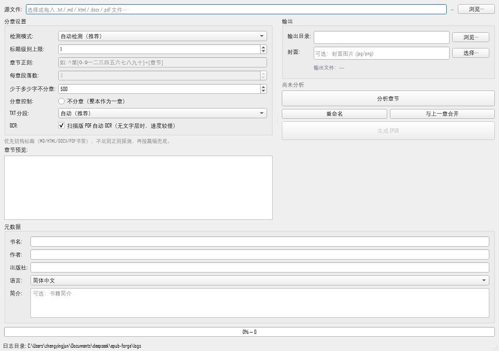

# Epub Forge — Windows 桌面级多格式文档转 EPUB 工具

把 TXT / Markdown / HTML / DOCX / PDF 一键转换为排版良好的 EPUB3 电子书，
并**根据源文件自动分章**。



## 功能特性

- **多格式输入**：`.txt`、`.md/.markdown`、`.html/.htm/.xhtml`、`.docx`、`.pdf`
- **自动分章**（核心能力）：
  - 优先识别文档自带结构标题：Markdown `#`、HTML `h1~h6`、Word「标题 1/2/3」样式、PDF 书签大纲
  - 结构标题不足时，用正则探测纯文本标题：`第X章 / 卷X / Chapter N / 一、 / 1.` 等（中英文）
  - 都没有时按篇幅兜底切分（可调每章段落数与最小字数）
  - 也支持**自定义正则**匹配任意章节起点
  - 可勾选「不分章（整本作为一章）」跳过分章（GUI 单选框 / CLI `--no-split`）
- **扫描版 PDF OCR**：PDF 无文字层（扫描版）时自动启用本地 OCR（RapidOCR/PP-OCRv4，中文），
  单行标题识别自动分章；GUI 勾选「扫描版自动 OCR」或 CLI 加 `--ocr`
- **分章预览与编辑**：章节列表实时预览，双击重命名、右键/按钮合并章节
- **智能段落识别**：TXT 自动识别三种排布——空行分段 / 逐行一段 / 无空行按行分段
  （避免「顶行」文件被并成文字墙）；超长段落自动在句末标点处分行
- **自动排版行距**：段落输出内置行距 1.9、段距 0.9em、首行缩进 2 字（内联样式兜底，
  即使阅读器忽略外部 CSS 也不会挤在一起）；扫描版 OCR 按行距/缩进自动分段
- **内容完整性自检**：解析后对比源文字数，疑似丢字时在日志中给出警告；HTML/MD 的裸文本（无标签包裹的文字）完整保留
- **排版**：首行缩进、段间距、行高、章标题样式内置 CSS；源文档标题不重复渲染
- **元数据**：书名、作者、出版社、语言、简介，输出 EPUB3 标准元数据
- **封面**：可选封面图片（自动生成封面页）
- **图片嵌入**：MD/HTML/DOCX 中的图片自动抽取嵌入 EPUB
- **桌面体验**：PySide6 原生窗口、文件拖拽、后台线程转换不卡界面、进度条与日志
- **无 pip 也能跑**：`tools/fetch_deps.py` 直接通过 PyPI API 下载依赖到 `.deps/`

## 快速开始

```powershell
# 1) 安装依赖（二选一）
python tools/fetch_deps.py        # 免 pip，直接拉 wheel 到 .deps/（自动切换国内镜像）
# 或
pip install -r requirements.txt

# 2) 启动（双击 start.bat 亦可）
python run.py
```

也可以命令行一键转换（见下方 CLI 用法）。

## CLI 用法

`run.py` 无参数时启动图形界面；带参数时执行命令行转换：

```powershell
python run.py input.docx -o out.epub --author 张三 --title 我的书
python run.py novel.txt --mode auto --max-level 1
python run.py book.md --mode size --paras 10
python run.py manual.pdf --cover cover.png --outdir dist
python run.py 扫描版.pdf --ocr -o 扫描版.epub        # 扫描版 PDF 走 OCR
```

参数：

| 参数 | 说明 | 默认 |
|---|---|---|
| `-o, --output` | 输出 EPUB 文件路径 | 源文件同目录 |
| `-t, --title` | 书名 | 自动推断 |
| `-a, --author` | 作者 | 空 |
| `-p, --publisher` | 出版社 | 空 |
| `-l, --lang` | 语言代码 | zh |
| `--desc` | 简介 | 空 |
| `--cover` | 封面图片路径 | 无 |
| `--mode` | 分章模式: auto/heading/regex/size | auto |
| `--max-level` | 标题级别上限(0=不限) | 1 |
| `--regex` | 自定义章节正则 | 空 |
| `--paras` | 按篇幅时每章段落数 | 8 |
| `--min-chars` | 少于该字数不分章 | 500 |
| `--no-split` | 不分章：整本作为一章 | 关 |
| `--txt-paras` | TXT 分段: auto/blank/line | auto |
| `--ocr` | 扫描版 PDF 启用 OCR（无文字层时，速度较慢） | 关 |

## 分章策略说明

| 模式 | 行为 |
|---|---|
| `auto`（默认） | 结构标题 → 文本正则探测 → 按篇幅兜底 |
| `heading` | 只用结构标题，不足则按篇幅兜底 |
| `regex` | 自定义正则匹配标题行，未命中按篇幅兜底 |
| `size` | 忽略标题，纯按段落数切分 |

常见纯文本标题正则（内置）：`第X章/节/回/卷/部/篇`、`卷X`、`Chapter N`、`序章/楔子/尾声`、`一、`、`1.`、全大写短行等。

## 测试与截图

```powershell
python tests/make_samples.py     # 生成 samples/ 下的 DOCX / PDF / PNG 样例
python tests/smoke_test.py       # 端到端冒烟测试：全格式解析→分章→生成→严格校验
python tests/verify_epub.py out.epub   # 校验单个 EPUB 的 spine/nav/CSS 结构
python tests/screenshot.py       # 离屏渲染 GUI 截图到 docs/gui.png
python tools/debug_parse.py 你的书.txt  # 诊断解析结果（内容是否完整/编码/末尾块）
```

## 项目结构

```
epub-forge/
├── run.py                  # 启动器（GUI / CLI）
├── epubforge/
│   ├── sources.py          # 多格式解析（TXT/MD/HTML/DOCX/PDF + 图片抽取）
│   ├── chapter.py          # 自动分章引擎
│   ├── builder.py          # EPUB3 生成（ebooklib）
│   ├── gui.py              # PySide6 桌面界面
│   ├── blocks.py           # Block/Chapter 数据模型
│   └── utils.py            # 编码探测等工具
├── tools/fetch_deps.py     # 免 pip 依赖安装器
├── tools/debug_parse.py    # 解析诊断工具（查内容丢失/编码问题）
├── tests/smoke_test.py     # 端到端冒烟测试（含 EPUB 结构严格校验）
├── tests/verify_epub.py    # 校验单个 EPUB 的 spine/nav/CSS 结构
├── build_exe.py            # PyInstaller 打包脚本
└── samples/                # 测试样例
```

## 打包成独立 exe

```powershell
python build_exe.py
# 产物在 dist/EpubForge.exe
```

（需要先安装 PyInstaller；建议在干净环境执行 `pip install pyinstaller`。）

## 已知限制

- 扫描版 PDF（无文字层）默认不识别，需启用 OCR（GUI 勾选或 CLI `--ocr`）；OCR 速度约 5~8 秒/页
- OCR 识别有少量错字（如 制→制约 误识），属正常现象
- PDF 图片暂不抽取（仅文本）
- 网络图片不自动下载
- TXT 段落排布为启发式识别（自动模式），复杂排版可在 GUI「TXT 分段」或 CLI `--txt-paras` 手动指定

## License

MIT
